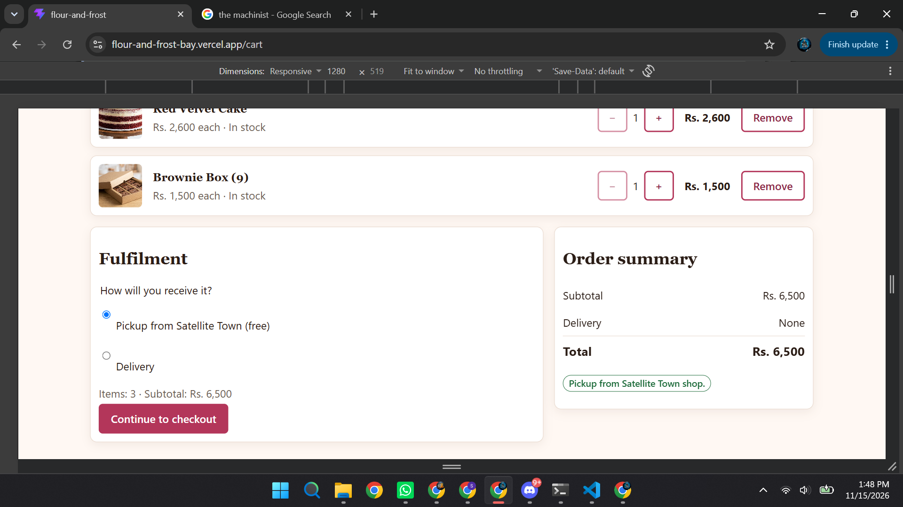
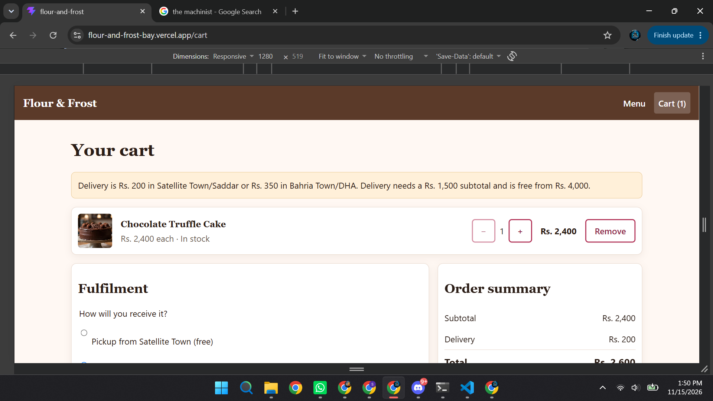
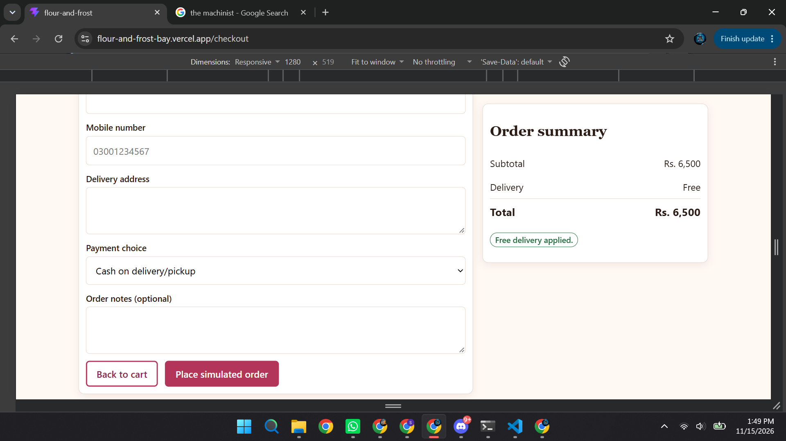
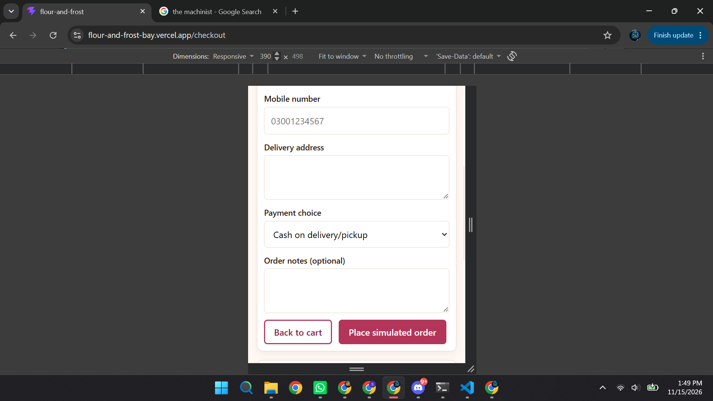
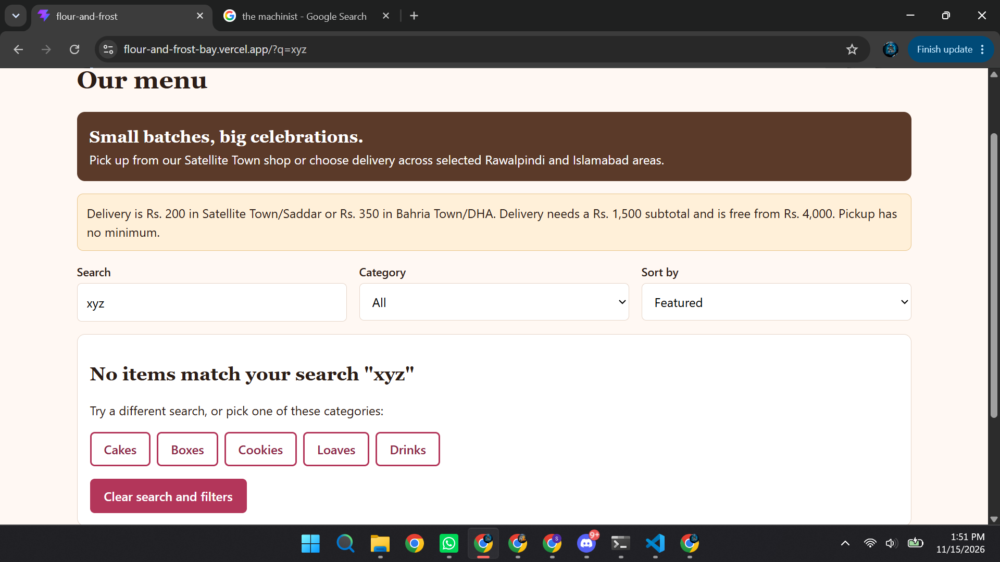

# Frontend Decisions — Flour & Frost

Draft entries. Edit the wording so it reflects what you actually build, and fill in
the code locations and evidence once the features exist.

## Decision 1: Shared cart for multi-item orders (interaction / state)

| Field | Content |
|---|---|
| Problem | Desi Rang: products can only be ordered one at a time through WhatsApp, so a customer cannot build and review a multi-item order. |
| Decision | Keep one cart state in `App` (`useState`, functional updates). Pass it to listing, details, cart and summary through props and callbacks. Save it to local storage. |
| Alternative | React Context with `useReducer`. |
| Reason | One source of truth keeps quantities consistent across all screens, and a customer can add, edit and review several items before ordering. |
| Tradeoff | Props are passed through several components, which is more verbose than Context. |
| Code location | `src/App.jsx` (`addToCart`, `changeQuantity`, `removeItem`); `src/pages/CartPage.jsx`; `src/utils/cart.js` (`reconcileCart`) |
| Evidence | Steps: add 3 items from the menu and item pages, change quantities, check the header count.   |

## Decision 2: Full cost breakdown before confirming (information hierarchy / mobile layout)

| Field | Content |
|---|---|
| Problem | Kitchen Khaas: delivery is charged per kilometre and confirmed after the order, so the payable amount is unknown at checkout. |
| Decision | Show the delivery rules in a banner on the menu and cart. Show subtotal, delivery fee and final payable amount together in the summary, updated live when the area or method changes. |
| Alternative | Reveal the delivery fee only on the final checkout step. |
| Reason | Customers see the final amount before they commit, which reduces surprise and cancellations. |
| Tradeoff | The customer must choose pickup or delivery and an area earlier in the flow. |
| Code location | `src/rules/pricingRules.js` (`evaluateOrder`); `src/components/OrderSummary.jsx` |
| Evidence | Steps: add items, switch between pickup and delivery and change the area, watch the fee and total update.   |

## Decision 3: Helpful empty state for no-match searches (interaction / state)

| Field | Content |
|---|---|
| Problem | Sweet Palace: an empty category shows "no products" with no alternatives or next step. |
| Decision | Separate "no items exist" from "filters match nothing". For no matches, show the active filters, a "Clear filters" button and links to categories that have items. |
| Alternative | Automatically relax filters until something matches. |
| Reason | The customer keeps control and always has a clear next action. |
| Tradeoff | Needs extra logic to work out which categories still have stock. |
| Code location | `src/components/EmptyState.jsx`; `src/pages/MenuPage.jsx` |
| Evidence | Steps: search for "xyz", then click a category or Clear search and filters.  |
